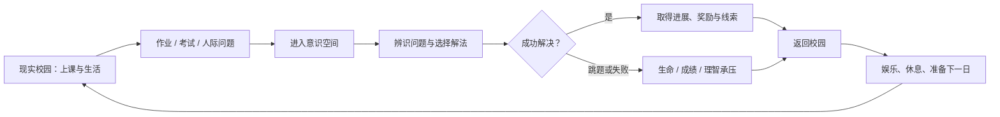
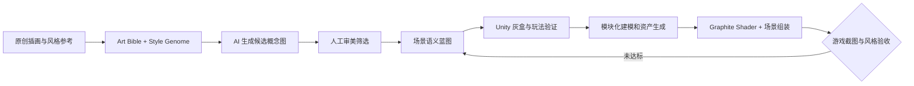

# 开发路线图

## 现行阶段与依赖

| 阶段 | 依据与出口 |
|---|---|
| W1–W2 前期 | [冲刺表](CURRENT_SPRINT.md)维护任务和证据，出口为可执行的设计规格。 |
| W3–W6 原型 | D016 采用 [WP 工作包](../02_design_proposals/preproduction/PRODUCTION_PIPELINE.md)替代原型周表。按工作包门槛启动。 |
| 小切片 WP9 | 验证陶舍、意识空间遭遇、回归、自由时段及次日反馈。其范围见[切片提案](../02_design_proposals/preproduction/FIRST_SLICE_DESIGN.md)。 |
| W7–W16 垂直切片 | 以原稿 §七八项验收为准。早期范例中的教学楼、敌人和 Boss 等实现细节属历史规划，具体内容需要用户裁定。WP9 后规划完整一天、跨房间复用与存读档。 |
| W17 起 | 生产、Alpha、Beta、发行阶段及关卡门槛见原稿 §二。W16 未通过时按 D016 和原门槛复盘。 |

项目目录和旧文件别名见 [README](../../README.md)，AI 工作权限见 [AGENTS.md](../../AGENTS.md)。下文保存旧计划的估算、周表、验收及协作示例，供追溯。正式任务状态由冲刺表维护。

## 原稿存档

> **整理说明（2026-11-15，Claude 应用户要求整理）**
> - 本文件保留用户提供的路线图原文。仅把三张导出失效的流程图（原为大段 CSS 代码）改写为可读的 Mermaid 图，并删去一个乱码字符；文字内容未改。
> - 与之后的决定冲突处，以决策记录为准：前期阶段 Claude 的角色见 D005；W3–W6 的“轻攻击、闪避、敌人状态机”按 D016 不执行，改按 PRODUCTION_PIPELINE.md 的工作包；文件名对应见 D017（GAME_BIBLE = GAME_MASTER.md，ART_BIBLE = ART_DIRECTION.md，DECISION_LOG = DESIGN_DECISIONS.md）。
> - 当前冲刺：CURRENT_SPRINT.md。

# 《双世界校园》独立游戏 Production Roadmap v1.0


项目规划基线

Unity · Claude 辅助开发

PC 单机


我建议把这款游戏定位为一部有日程压力的校园超现实动作 RPG，而不是传统魂系游戏，也不是单纯的校园生活模拟器。

它最有价值的原创机制是：

> 学生面对的“问题”，在意识空间里变成可以战斗的实体；知识和解题思路就是武器，而逃避问题会产生现实代价。

视觉上，现实世界提供鲜明、热闹的校园生活；意识空间则进入你原创的石墨手绘、巨大肢体和空间异化的世界。两者的反差既服务于叙事，也服务于玩法。

## 一、项目规模和时间基线

以下按你独立主导、Claude 承担大量编程与工具开发工作估算，时间是规划目标，不是完成保证。

完整游戏目标

# 6–8 小时

开发周期基线

# 12–18 个月

首个可玩原型

# 6 周

首个垂直切片

# 16 周

假设：每周投入 25–35 小时；Windows PC 优先；单机；无联网、无开放世界、无复杂社交模拟。首个切片 15–20 分钟，先验证生产能力。

## 二、整体开发阶段

1. Pre-production · 第 1–2 周

   锁定游戏核心循环、双世界规则、叙事主线、技术标准与美术规则

   出口：可执行设计规格
2. Prototype · 第 3–6 周

   实现移动、作息时间、解题战斗、跳题惩罚和世界切换，全部使用临时资产

   出口：10 分钟可玩原型
3. Vertical Slice · 第 7–16 周

   完成一个教学楼章节，验证最终级别的画面、机制、动画、音效、剧情和资产管线

   核心里程碑：可展示 Demo
4. Production · 第 17–40 周

   按统一模板制作图书馆、体育馆、实验楼等章节，同时扩展题库、敌人和剧情

   出口：主要内容齐备
5. Alpha · 第 41–44 周

   全游戏从开始到结局可通关；功能冻结，修复阻塞性问题
6. Beta · 第 45–50 周

   外部试玩、难度平衡、存档测试、性能优化、无障碍与文本校对
7. Release · 第 51–56 周

   商店素材、预告片、正式构建、发行准备与首发问题修复

56 周为理想基线。第 16 周若垂直切片未通过验收，应减少范围或延长研发，不应直接进入批量内容生产。

## 三、必须同步推进的六条生产线

| 生产线   | 主要工作                    | 最终负责人         |
| ----- | ----------------------- | ------------- |
| 游戏设计  | 核心循环、战斗、题目、经济平衡、日程      | 你             |
| 叙事设计  | 世界观、人物、章节、对白、结局         | 你             |
| 工程开发  | Unity、C#、存档、敌人 AI、编辑器工具 | Claude 执行，你验收 |
| 美术生产  | 风格模型、概念图、建模、Shader、场景   | 你负责审美决策       |
| 音频动画  | 角色动作、打击反馈、音乐、音效         | 工具/素材辅助，你验收   |
| 品质与发行 | 测试、性能、商店页面、演示版          | 你主导           |

这六条线并不是六个独立部门。对独立开发而言，真正合理的组织方式是：每两周围绕一个可玩的功能增量，让六条线各自交付必要部分。

例如实现“第一次考试”，就同时完成考试剧情、一道题目、一个对应敌人、一段进入意识空间的过渡、相关音效以及可重复测试。

## 四、你的第一版核心循环



注意一个关键设计：解题战斗必须具有玩家可理解的策略。不能只是把题目贴在敌人头顶，再让玩家选择一个正确答案。

我建议初期设计三类解法技能：

- 拆解：针对复合型问题，拆分敌人的护盾或肢体。
- 转化：改变问题形态，例如把复杂结构变成可直接攻击的弱点。
- 验证：识破错误条件、反击伪解或揭露隐藏机制。

第一版先做 6 道经过手工设计的题目、3 种战斗原型。不要直接让大模型无限生成题目并决定答案。题目、解法、敌人行为与奖励都应该由可测试的结构化数据控制。

## 五、艺术资产流水线

这是项目的第二条关键路径。建议将你现有三张原创插画作为起点，但不要把三张画当成足以训练稳定风格模型的完整数据集。



（整理注：原图中“未达标”的返回点无法从导出文本确定，此处暂画回“场景语义蓝图”。）

建议设立三道独立验收：

1. 概念一致性：看起来是不是属于你的艺术世界？
2. 空间可玩性：玩家移动、视线、战斗与敌人导航是否正常？
3. 生产可重复性：换一个教室、题目或构图参数，是否能复用现有资产和工具？

这意味着你需要优先生产的不是 100 张概念图，而是：

- 1 套校园模块（墙、门、窗、地板、课桌）。
- 1 套石墨材质和光照规则。
- 1 套超现实肢体资产。
- 1 个场景配方格式。
- 1 个 Unity 场景组装编辑器。
- 1 套截图对比与验收流程。

第 16 周前，争取做到：使用同一套资产，在不新增手绘插画的前提下，制作出三个视觉构图不同、但风格统一的意识空间房间。

这是比“训练出了 LoRA”更有价值的阶段性成果。

## 六、前 16 周的具体任务

| 周次  | 核心任务                     | 验收结果            |
| --- | ------------------------ | --------------- |
| W1  | 游戏设计基线、玩家体验、世界观规则        | `GAME_BIBLE.md` |
| W2  | 技术架构、叙事大纲、Art Bible、版本控制 | 可执行项目规范         |
| W3  | 玩家移动、摄像机、交互              | 灰盒校园可探索         |
| W4  | 轻攻击、闪避、敌人状态机             | 单敌人战斗可玩         |
| W5  | 题目数据结构、解法技能、正确性判定        | 3 道题目可战斗        |
| W6  | 日程、生命/理智、跳题、双世界切换        | 10 分钟闭环原型       |
| W7  | 教学楼章节布局与剧情事件             | 完整灰盒关卡          |
| W8  | 校园模块库、人物基础模型和动画          | 资产能反复使用         |
| W9  | 石墨 Shader、轮廓、排线与纸张质感     | 风格测试房间          |
| W10 | 巨手等超现实资产、构图锚点            | 3 种意识空间组合       |
| W11 | 第一种完整解题敌人和视觉反馈           | 可读的战斗体验         |
| W12 | 第二种敌人、教学 Boss、战斗平衡       | 完整章节战斗          |
| W13 | 日程 UI、作业/考试 UI、存档        | 跨场景状态保留         |
| W14 | 剧情对白、场景演出、声音、音乐          | 章节视听完整          |
| W15 | 内部试玩、Bug 修复、优化           | 无阻塞性缺陷          |
| W16 | 打包 Demo、外部试玩、评审          | 垂直切片验收          |

## 七、第 16 周必须通过的验收

Vertical Slice 验收清单

0/8 已验证

玩家能完成一天校园日程，且日程选择有明确代价

至少一次解题战斗包含两种合理策略

能主动跳题，并观察到生存与学业后果

现实与意识空间的切换在剧情和玩法上成立

至少三种超现实房间复用同一套视觉生产工具

存档、读取、返回菜单及重新进入游戏正常

15–20 分钟关卡可由新玩家独立完成

外部试玩者能理解主要机制，并愿意继续探索

这是项目关卡门槛，不是例行检查。未通过时优先修复关键体验，再决定是否增加内容。

尤其注意：前 16 周最容易失败的不是编程，而是两个设计风险。

第一，“解题”会不会打断动作游戏的节奏？ 需要早期测试它究竟应该是实时技能选择、短暂慢动作、暂停式策略，还是混合系统。

第二，灰色石墨空间是否能提供清楚的战斗信息？ 手绘质感不能让敌人的攻击前摇、可行走区域和交互物变得难以辨认。

这两件事都可能要求修改设计，不能通过简单增加 AI 生成资产解决。

接下来我会把这份规划进一步整理为完整的长期项目文档，补充第 17–56 周内容生产安排、风险与预算、技术结构、任务模板和 Claude 工作规程。

翻译成你的实际开发顺序，最重要的前四步是：

先确定一日循环 → 做一道能战斗的题目 → 做一次真正有意义的双世界切换 → 用你的原创画风完成一个可玩的教室。

这四步成立，项目才真正拥有可以扩展的基础。

---

你可以把这份 Roadmap 当作整个 ChatGPT Project 的项目管理总纲，让它长期指导 Claude 和我的工作。

不过，我建议你不要只把整篇路线图粘贴进 Project。最有效的方式是建立一个三层结构：

1. Project Instructions：规定 AI 如何参与开发。
2. Project Files：保存游戏设计、技术架构、美术规范、开发路线图。
3. 每周开发对话：执行具体任务，并将结果更新到项目文件。

## 一、建议的 Project 结构

创建一个 ChatGPT Project，名称例如：

《双世界校园｜Game Development》

然后在项目中保存以下文件：

| 文件                      | 作用                 | 更新频率    |
| ----------------------- | ------------------ | ------- |
| `GAME_BIBLE.md`         | 游戏定位、世界观、核心玩法      | 重大设计变动时 |
| `PRODUCTION_ROADMAP.md` | 56 周开发路线图、阶段目标     | 每个阶段复盘  |
| `ART_BIBLE.md`          | 你的原创插画风格、视觉生成规则    | 风格调整时   |
| `TECH_ARCHITECTURE.md`  | Unity 架构、代码规范、系统关系 | 技术决策变更时 |
| `CURRENT_SPRINT.md`     | 当前两周要完成的开发任务       | 每两周     |
| `DECISION_LOG.md`       | 记录为什么选择或放弃某种方案     | 每次重要决策后 |

你之前上传的三张插画，也应该保留在 Project 中，作为意识空间的原始美术参考。

## 二、Project Instructions 应该怎么写？

你可以直接复制下面这段。

# 双世界校园独立游戏 · Project Instructions

## 你的身份

你是本项目的长期游戏制作顾问、技术架构师和项目管理助手。

项目由我担任创意总监和最终决策者，Claude 主要负责具体的编码、工具开发和技术实现。

你的任务是维护项目整体一致性，防止需求膨胀，并确保每项工作服务于最终可玩的游戏。

## 游戏核心设定

- 类型：第三人称战斗生存、校园生活模拟、超现实叙事 RPG。
- 世界：明亮高饱和的现实校园，与灰色石墨手绘风格的意识空间。
- 玩法：学习问题在意识空间中具象化，解题方法对应战斗技能。
- 生存：跳题消耗生命值，成绩持续下降影响理智；娱乐、休息等活动用于恢复。
- 日程：上课、作业、考试、吃饭、休息及自由活动。
- 主题：后现代荒诞、无奈以及存在主义式的希望。
- 美术：以我提供的原创插画为核心参考，建立可重复使用的 AI 美术及 3D 场景生产线。
- 开发：Unity、C#，Claude 辅助执行。
- 首发目标：PC 单机。

## 工作规则

1. 所有建议必须参考 `GAME_BIBLE.md` 和 `PRODUCTION_ROADMAP.md`。
2. 优先完成可玩的核心循环，再扩展剧情和美术内容。
3. 重要技术决定必须说明成本、风险和替代方案。
4. 不得未经确认添加大型系统或扩大项目规模。
5. 将开发工作拆分为可验收的任务，明确输入、输出和完成标准。
6. 对 Claude 的工作提出可以直接执行的任务说明。
7. 每两周进行一次 Sprint Review。
8. 发现当前开发方向偏离项目核心时，主动提出纠正建议。
9. 每次重要决策应建议更新对应项目文档。
10. 不得声称代码、场景或测试已经完成，除非有实际验证结果。

## 日常工作方式

当我说“开始本周开发”时：

- 读取路线图和当前 Sprint。
- 确定当前阶段的关键目标。
- 将目标分解为优先级明确的开发任务。
- 为 Claude 编写执行提示词。
- 列出验收方法和预期交付物。

当我说“本周复盘”时：

- 对照验收标准检查完成情况。
- 区分已验证、待验证和未完成事项。
- 评估技术债务与制作风险。
- 建议下一周的任务。
- 给出需要同步回项目文件的具体变更。

## 三、ChatGPT 和 Claude 应该怎样协作？

我建议采用下面的分工：


（整理注：“否”的返回点按常规推断为回到开发。）

其中有一点很重要：

ChatGPT Project 和 Claude Code 不会天然共享全部上下文。

最好把项目的正式设计文件放在 Unity 工程的 `Docs/` 文件夹中，并使用 Git 管理。

例如：

```
MySchoolGame/
├── Assets/
├── Packages/
├── ProjectSettings/
├── Docs/
│   ├── GAME_BIBLE.md
│   ├── PRODUCTION_ROADMAP.md
│   ├── ART_BIBLE.md
│   ├── TECH_ARCHITECTURE.md
│   ├── CURRENT_SPRINT.md
│   └── DECISION_LOG.md
├── CLAUDE.md
└── README.md
```

ChatGPT 负责审查和制定计划，Claude 在本地读取这些文件并执行。每次有重要变更，再把更新后的文件同步到 ChatGPT Project。

这样不会出现两边使用不同版本设计文档的问题。

## 四、你每周实际怎么用？

第一周的操作示例

1. 周初：向 ChatGPT 下达规划指令

   “按照 Roadmap，制定 W1 开发计划。列出任务依赖、每天的目标以及验收标准。”
2. 开发时：把单个任务交给 Claude

   “读取 `GAME_BIBLE.md` 和 `TECH_ARCHITECTURE.md`，实现任务 W1-03。先说明架构，不要修改无关模块。完成后运行测试。”
3. 任务结束：记录真实结果

   将完成的功能、Git commit、测试结果、Bug、未解决的问题写进 Sprint 记录。
4. 周末：返回 ChatGPT 审查

   “这是本周提交记录和测试结果。对照路线图检查完成情况，并制定下周计划。”

## 五、现阶段你最应该做的事

我建议先建立 Project，再分三步推进：

- 第一步： 把这份 Roadmap 保存为 `PRODUCTION_ROADMAP.md`。
- 第二步： 根据我们已经确定的世界观和玩法，完成 `GAME_BIBLE.md`。
- 第三步： 建立 `CURRENT_SPRINT.md`，正式启动 W1。

需要特别说明：ChatGPT Project 中的路线图属于规划依据，而不是自动执行程序。你仍然需要按 Sprint 启动任务、验收成果并维护进度；如果设置定时任务，可以用来提醒或定期生成复盘，但它不等于 Claude 会自动修改 Unity 工程。

我的建议：让 ChatGPT Project 成为你的“制作管理室”，Claude Code 成为“开发工作室”，Git 仓库成为唯一的工程事实来源。

这样你就能在保持创意控制权的同时，把大量具体制作工作交给 AI。